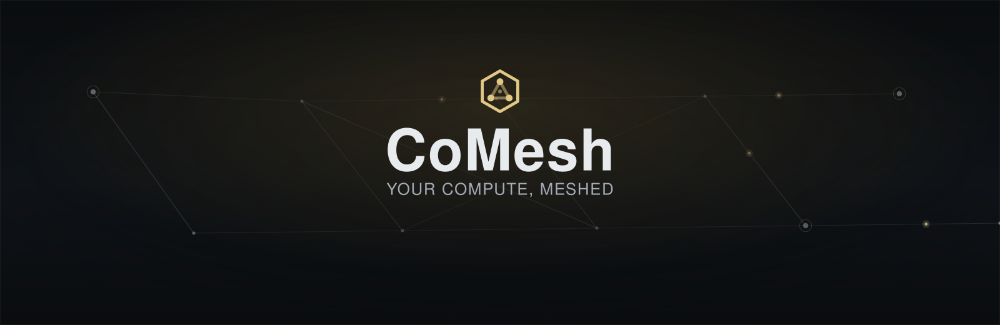
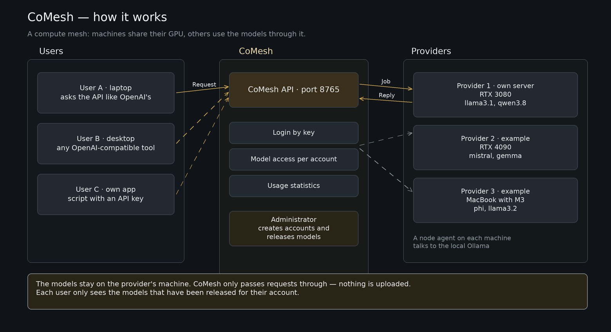

<p align="center">
  
</p>

# CoMesh

**English** · [Deutsch](#deutsch)

A self-hosted platform for shared GPU capacity: machines publish their AI models as
an endpoint, everyone else uses them through a single OpenAI-compatible API.

## What CoMesh is

CoMesh pools the compute of several machines. If you have a GPU, you run a small
agent next to your local inference server — Ollama or any OpenAI-compatible
backend — and the agent represents it to the pool. If you need models, you point an
OpenAI client at the portal and get, per request, a machine that offers the model
and has the memory for it.

The portal is the only fixed address involved: it accepts requests, picks the node,
books the usage and shows both in a web interface.

## What it does

- **OpenAI-compatible API** — `GET /v1/models`, `POST /v1/chat/completions`,
  streaming via server-sent events. Any OpenAI client works unchanged.
- **Many nodes, one address** — selection by free VRAM, the node's model list, the
  account's model list and current load.
- **Releases per node and per account** — a node offers only what its list allows,
  an account only sees what was released to it; `GET /v1/models` returns exactly
  that intersection.
- **Accounts with credits** — usage is measured in credits (optional); sign-ups are
  approved by an administrator.
- **Administration with an audit log** — approvals, roles, passwords, credits, keys
  and model releases in the UI; every change is logged, keys and passwords never in
  plain text.
- **No open port on a node** — the agent connects outbound over WebSocket, so NAT,
  firewalls and changing addresses do not matter.
- **One-command install** — prebuilt binaries for Linux, macOS and Windows with a
  checksum, registered as a service (systemd, launchd, Task Scheduler) without
  administrator rights.
- **Web interface** with chat, device list, usage and administration — German and
  English.

## Quickstart

### 1. Start the portal (operator)

```bash
git clone https://github.com/lanlibbi/CoMesh.git && cd CoMesh
cp .env.example .env
# in .env: set ADMIN_API_KEY and ADMIN_EMAIL for the first admin
docker compose up -d --build
```

- UI: <http://localhost:8767>
- API: <http://localhost:8765>
- Check the install without a key: `scripts/check_setup.sh http://localhost:8765`

Both ports are bound to `127.0.0.1` by default. To serve other machines (LAN,
reverse proxy, tunnel), set `COMESH_BIND_ADDRESS=0.0.0.0` in `.env` **before** the
first start and recreate the containers — see [docs/network.md](docs/network.md).

### 2. Contribute a machine (provider)

You need an account with the `provider` role (granted by an administrator) and a
running backend on the same machine: Ollama on `127.0.0.1:11434`, or an
OpenAI-compatible server such as LM Studio on `127.0.0.1:1234`.

```bash
curl -fsSL https://<portal>/downloads/install.sh | sh     # macOS, Linux
```

```powershell
powershell -ExecutionPolicy Bypass -Command "irm https://<portal>/downloads/install.ps1 | iex"          # Windows
```

The installer verifies the SHA-256 checksum, asks for the account key without
echoing it and sets up the service. Failure modes, updates and removal are covered
in [docs/install.md](docs/install.md).

Working from the repo instead: `cd node-agent && python3 setup.py && docker compose up -d`.

### 3. Send a first request (user)

1. Create an account on `/register.html` and wait for approval.
2. Issue an API key in your profile (`gpu_…`, shown once).
3. Call the API:

```bash
curl https://<portal>/v1/chat/completions \
  -H "Authorization: Bearer gpu_…" \
  -H "Content-Type: application/json" \
  -d '{"model": "qwen2.5-coder:7b",
       "messages": [{"role": "user", "content": "Hello CoMesh!"}],
       "stream": false}'
```

A local install without HTTPS answers on `http://localhost:8765/v1`; there `8765`
replaces the public hostname and no port is added to the public form. `GET
/v1/models` with the same key lists the models your account may use; which machine
served a request shows up in the portal's device list afterwards.

Runnable example: [examples/client.py](examples/client.py).

## How it is built



- **Portal** (FastAPI + SQLAlchemy): API, pool logic, billing, accounts and the web
  UI. The only address a client knows.
- **Node agent** (Python, shipped as one binary): runs on every provider machine,
  reports GPU, memory and load, and forwards jobs to the local backend — native
  Ollama or any OpenAI-compatible server (`BACKEND=openai`).
- **Transport**: the agent connects outbound (`/agent/connect`). The portal never
  calls a node, so no node needs an open port.

More detail: [ARCHITECTURE.md](ARCHITECTURE.md),
[docs/architecture.md](docs/architecture.md), [docs/node-agent.md](docs/node-agent.md).

## What it is not

- **Not a finished product.** At 0.6.10; interfaces may still change.
- **No signed binaries.** Neither Apple notarisation nor a Windows signature — hence
  `curl` instead of a browser download.
- **No support and no availability guarantee.** The pool is made of private
  machines; when one goes away you get an error, not a late answer.
- **Not every platform.** `darwin-x86_64` and `linux-arm64` are missing today.
- **No confidentiality guarantee.** Input runs on someone else's machine — no
  passwords, no confidential documents.
- **No model catalogue sync.** What a node may offer is its list in the portal, not
  what happens to be installed locally.

## License and status

Version **0.6.10**; changes are listed in [CHANGELOG.md](CHANGELOG.md).

There is **no licence file** in the repository. Without an explicit licence the
statutory default applies (all rights reserved) — ask before reusing,
redistributing or using CoMesh commercially.

## Documentation

- [docs/install.md](docs/install.md) — install a provider node with one command
- [docs/guide.md](docs/guide.md) — beginner guide: first request, credits, error codes (German)
- [docs/api.md](docs/api.md) — API reference
- [docs/node-agent.md](docs/node-agent.md) — the node agent in detail
- [docs/network.md](docs/network.md) — addressing, DHCP, mDNS, optional mesh VPN
- [docs/windows.md](docs/windows.md) · [docs/macos.md](docs/macos.md) — providers on Windows and macOS
- [docs/agent-api.md](docs/agent-api.md) — full-access account for automation
- [docs/portal.md](docs/portal.md) — portal setup and configuration

---

# Deutsch

Eine selbst gehostete Plattform für gemeinsame GPU-Leistung: Rechner stellen ihre
KI-Modelle als Endpunkt bereit, alle anderen nutzen sie über eine einzige
OpenAI-kompatible API.

## Was ist CoMesh

CoMesh bündelt die Rechenleistung mehrerer Rechner zu einem Pool. Wer eine GPU
hat, betreibt darauf einen kleinen Agenten, der die lokale Inferenz — Ollama oder
ein beliebiger OpenAI-kompatibler Server — nach außen vertritt. Wer Modelle
braucht, richtet einen OpenAI-Client auf das Portal und bekommt pro Anfrage eine
Maschine, die das Modell anbietet und den Speicher dafür hat.

Das Portal ist die einzige feste Adresse im Spiel: es nimmt die Anfragen an, wählt
die Node, rechnet den Verbrauch ab und zeigt beides in einer Web-Oberfläche.

## Was es kann

- **OpenAI-kompatible API** — `GET /v1/models`, `POST /v1/chat/completions`,
  Streaming über Server-Sent Events. Jeder OpenAI-Client läuft unverändert dagegen.
- **Mehrere Nodes, eine Adresse** — die Auswahl erfolgt nach freiem VRAM,
  Modellfreigabe der Node, Freigabe des Kontos und aktueller Auslastung.
- **Freigaben pro Node und pro Konto** — eine Node bietet nur an, was in ihrer
  Liste steht; ein Konto sieht nur, was für es freigegeben ist. `GET /v1/models`
  liefert genau diese Schnittmenge.
- **Konten mit Guthaben** — Verbrauch wird in Credits gemessen (zuschaltbar),
  Registrierungen gibt die Administration frei.
- **Verwaltung mit Protokoll** — Freigaben, Rollen, Passwörter, Credits, Schlüssel
  und Modellfreigaben in der Oberfläche; jede Änderung landet im Audit-Log,
  Schlüssel und Passwörter nie im Klartext.
- **Kein offener Port auf der Node** — der Agent verbindet sich ausgehend per
  WebSocket. NAT, Firewall und wechselnde Adressen sind kein Thema.
- **Installation in einem Befehl** — fertige Binaries für Linux, macOS und
  Windows, mit Prüfsumme, als Dienst (systemd, launchd, Aufgabenplanung) und ohne
  Administratorrechte.
- **Web-Oberfläche** mit Chat, Geräteliste, Verbrauch und Verwaltung — deutsch
  und englisch.

## Schnellstart

### 1. Portal starten (Betreiber)

```bash
git clone https://github.com/lanlibbi/CoMesh.git && cd CoMesh
cp .env.example .env
# in .env: ADMIN_API_KEY und ADMIN_EMAIL für den ersten Admin setzen
docker compose up -d --build
```

- Oberfläche: <http://localhost:8767>
- API: <http://localhost:8765>
- Installation prüfen, ohne Schlüssel: `scripts/check_setup.sh http://localhost:8765`

Beide Ports liegen standardmäßig nur auf `127.0.0.1`. Soll das Portal von anderen
Rechnern erreichbar sein (LAN, Reverse Proxy, Tunnel), in der `.env` **vor** dem
ersten Start `COMESH_BIND_ADDRESS=0.0.0.0` setzen und die Container neu erzeugen —
siehe [docs/network.md](docs/network.md).

### 2. Rechner beisteuern (Provider)

Nötig sind ein Konto mit Rolle `provider` (vergibt die Administration) und ein
laufendes Backend auf demselben Rechner: Ollama auf `127.0.0.1:11434` oder ein
OpenAI-kompatibler Server wie LM Studio auf `127.0.0.1:1234`.

```bash
curl -fsSL https://<portal>/downloads/install.sh | sh     # macOS, Linux
```

```powershell
powershell -ExecutionPolicy Bypass -Command "irm https://<portal>/downloads/install.ps1 | iex"          # Windows
```

Der Installer prüft die SHA-256-Summe, fragt den Account-Schlüssel verdeckt ab und
richtet den Dienst ein. Fehlerbilder, Aktualisieren und Entfernen stehen in
[docs/install.md](docs/install.md).

Wer aus dem Repo heraus arbeitet, nimmt den Container-Weg:
`cd node-agent && python3 setup.py && docker compose up -d`.

### 3. Erste Anfrage (Nutzer)

1. Auf `/register.html` ein Konto anlegen und freischalten lassen.
2. Im Profil einen API-Schlüssel ausstellen (`gpu_…`, wird einmal angezeigt).
3. Aufrufen:

```bash
curl https://<portal>/v1/chat/completions \
  -H "Authorization: Bearer gpu_…" \
  -H "Content-Type: application/json" \
  -d '{"model": "qwen2.5-coder:7b",
       "messages": [{"role": "user", "content": "Hallo CoMesh!"}],
       "stream": false}'
```

Eine lokale Installation ohne HTTPS antwortet unter `http://localhost:8765/v1` —
dort ersetzt `8765` die öffentliche Adresse; ein Port gehört nur in diese Variante.
Welche Modelle erlaubt sind, sagt `GET /v1/models` mit demselben Schlüssel. Welche
Maschine die Anfrage bedient hat, steht danach in der Geräteliste des Portals.

Fertiges Beispiel: [examples/client.py](examples/client.py).

## Wie es aufgebaut ist


- **Portal** (FastAPI + SQLAlchemy): API, Pool-Logik, Abrechnung, Konten und
  Web-Oberfläche. Die einzige Adresse, die ein Client kennt.
- **Node-Agent** (Python, ein Binary): läuft auf jedem Provider-Rechner, meldet
  GPU, Speicher und Auslastung und vermittelt Aufträge an das lokale Backend —
  Ollama nativ oder jeden OpenAI-kompatiblen Server (`BACKEND=openai`).
- **Transport**: der Agent verbindet sich ausgehend (`/agent/connect`). Das Portal
  ruft keine Node an, deshalb braucht keine Node einen offenen Port.

Details und Datenflüsse: [ARCHITECTURE.md](ARCHITECTURE.md),
[docs/architecture.md](docs/architecture.md), [docs/node-agent.md](docs/node-agent.md).

## Was es nicht ist

- **Kein fertiges Produkt.** Stand 0.6.10; Schnittstellen können sich ändern.
- **Keine signierten Binaries.** Weder Apple-Notarisierung noch Windows-Signatur —
  deshalb der `curl`-Weg statt eines Downloads im Browser.
- **Kein Support- und kein Verfügbarkeitsversprechen.** Der Pool besteht aus
  privaten Rechnern; fällt einer aus, gibt es einen Fehler und keine späte Antwort.
- **Keine Vollabdeckung der Plattformen.** `darwin-x86_64` und `linux-arm64`
  fehlen derzeit.
- **Kein Aufbewahrungsversprechen.** Eingaben laufen über einen fremden Rechner —
  keine Passwörter, keine vertraulichen Dokumente.
- **Kein Model-Catalog-Sync.** Was eine Node anbieten darf, steht in ihrer Liste im
  Portal, nicht in dem, was lokal installiert ist.

## Lizenz und Stand

Version **0.6.10**; was sich geändert hat, steht in [CHANGELOG.md](CHANGELOG.md).

Im Repo liegt **keine Lizenzdatei**. Ohne ausdrückliche Lizenz gilt der gesetzliche
Standard (alle Rechte vorbehalten) — wer CoMesh weiterverwenden, weitergeben oder
kommerziell einsetzen will, sollte vorher fragen.

## Dokumentation

- [docs/install.md](docs/install.md) — Installation einer Provider-Node in einem Befehl
- [docs/guide.md](docs/guide.md) — Anleitung für Einsteiger: erster Aufruf, Credits, Fehlercodes
- [docs/api.md](docs/api.md) — API-Referenz
- [docs/node-agent.md](docs/node-agent.md) — Node-Agent im Detail
- [docs/network.md](docs/network.md) — Adressierung, DHCP, mDNS, optionales Mesh-VPN
- [docs/windows.md](docs/windows.md) · [docs/macos.md](docs/macos.md) — Provider unter Windows und macOS
- [docs/agent-api.md](docs/agent-api.md) — Vollzugangskonto für Automatisierung
- [docs/portal.md](docs/portal.md) — Portal-Setup und Konfiguration
