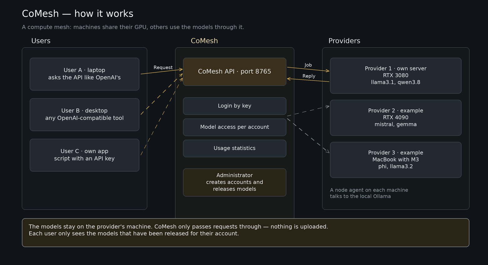

# CoMesh — Anleitung für Einsteiger

**Sprachen:** die Seite im Portal (`/guide.html`) schaltet zwischen **Deutsch, Englisch,
Spanisch und Französisch** um; die Wahl liegt in `localStorage.gp_lang` und gilt damit auch für die
übrigen Seiten.
Die Langfassung hier ist deutsch — bei Abweichungen gilt die Seite.

---

## English summary

The portal at the same address (without `/v1`) is the quickest way to try the pool: pick a model in
**Chat** and send — Enter sends, Shift+Enter breaks the line, and a checkbox switches to Ctrl+Enter.
**+ New** keeps several conversations side by side, each with its own history and model; a streaming
answer stays in the conversation it belongs to even if you switch tabs. Transcripts live in the
browser (`localStorage`) only.

Administrators additionally get **Accounts** (approve registrations, roles, passwords, credits, keys,
per-account model releases, optional e-mail notice via SMTP) and **Usage (all)** with sortable columns.
**Devices** lists every contributed machine; agent addresses are masked by default, an owner may choose
to appear as "anonym", and a "part-time" tag marks machines that do not run around the clock.

CoMesh is a shared way to reach computing power for AI models: members contribute machines
with free GPUs, everyone else uses them through one OpenAI-compatible endpoint. Two roles,
combinable: **users** need an OpenAI-compatible client and a key (nothing to install),
**providers** run the node agent as a container and decide which models their machine offers.

Getting started: create an account → wait for administrator approval → copy the key from the
profile (shown once) → call `<portal>/v1` (no port behind https; locally 8765 instead of 8767) →
watch usage under *My usage*. Send the key as `Authorization: Bearer <key>`; in a config file or
SDK only the key itself, the library adds `Bearer`. Usage is
measured in credits; contributing a GPU earns them. Errors: 401 key, 403 not approved,
429 too fast, 502 no machine offering the model, 524 timeout (use `stream=True`).
Your input runs on someone else's machine — no secrets, no personal data.

Diese Seite erklärt CoMesh für Menschen, die es nicht kennen. Die kurze Fassung liegt als
`frontend-alpine/guide.html` im Portal und ist dort ohne Anmeldung erreichbar (Menü „Anleitung").

## Was CoMesh ist

Ein gemeinschaftlicher Zugang zu Rechenleistung für KI-Modelle. Wer einen Rechner mit freier
Grafikkarte hat, stellt sie dem Pool zur Verfügung. Wer Modelle nutzen will, holt sie über eine
einzige Schnittstelle, die genauso aussieht wie die von OpenAI — ohne eigene Hardware und ohne Abo.

Zwei Rollen, kombinierbar:

* **Nutzer** — braucht nichts zu installieren. Ein OpenAI-kompatibler Client und ein Schlüssel
  genügen: die Weboberfläche, LM Studio, oder ein eigenes Skript.
* **Anbieter** — betreibt den Node-Agenten als Container. Er meldet die GPU an den Pool und nimmt
  Aufträge an. Welche Modelle der Rechner anbietet, legt der Betreiber fest.



*Drei Nutzer links, die CoMesh-API in der Mitte, drei Anbieter rechts. Die Datei zum
Weiterbearbeiten liegt unter `brand/comesh-setup.excalidraw`.*

## Erste Schritte

1. **Konto anlegen** auf `/register.html`. Danach ist das Konto angemeldet, aber nicht freigegeben.
2. **Freigabe abwarten** — ein Administrator schaltet es frei. Erst dann sind Modelle erreichbar.
3. **Schlüssel holen** im Profil. Er wird **einmal** angezeigt; ein neuer Schlüssel macht den alten
   ungültig.
4. **Ersten Aufruf machen** gegen `<portal>/v1`. Über einen öffentlichen Namen mit HTTPS **ohne
   Port** (443 ist implizit); im eigenen Netz stattdessen `http://<host>:8765/v1` — dort ist 8765
   die API und 8767 die Oberfläche.
5. **Verbrauch ansehen** unter „Mein Verbrauch".

## Erster Aufruf

```bash
curl -s https://PORTAL/v1/chat/completions \
  -H "Authorization: Bearer DEIN-SCHLUESSEL" \
  -H "Content-Type: application/json" \
  -d '{"model": "llama3.2", "messages": [{"role": "user", "content": "Sag kurz hallo"}]}'
```

```python
from openai import OpenAI

client = OpenAI(base_url="https://PORTAL/v1", api_key="DEIN-SCHLUESSEL")  # nur der Schluessel,
#                                                                      kein "Bearer " davor
antwort = client.chat.completions.create(
    model="llama3.2",
    messages=[{"role": "user", "content": "Sag kurz hallo"}],
    stream=True,
)
for stueck in antwort:
    print(stueck.choices[0].delta.content or "", end="", flush=True)
```

**Streaming einschalten.** Ohne `stream=True` kann eine lange Antwort an Zwischenschichten hängen
bleiben (524). Mit Streaming kommen die Wörter, während sie entstehen.

Welche Modelle gerade verfügbar sind: `GET /v1/models` mit demselben Schlüssel. Ein Modell kann
zusätzlich pro Konto freigegeben werden müssen.

## Schlüssel und Adresse

**Adresse.** Dieselbe Adresse, unter der du das Portal öffnest, plus `/v1` — fertig.

| Wie du das Portal erreichst | Adresse für Modelle |
| --- | --- |
| `https://comesh.lanlibbilab.me` (öffentlich) | `https://comesh.lanlibbilab.me/v1` — **kein Port** |
| `http://100.126.79.111:8767` (im eigenen Netz) | `http://100.126.79.111:8765/v1` — Port **8765** |

Ein Port gehört nur dann in die Adresse, wenn du ihn auch für das Portal brauchst. Hinter einem
öffentlichen HTTPS-Namen ist es 443, und das schreibt niemand mit. Im eigenen Netz sind es zwei
verschiedene Ports: **8767** für die Oberfläche, **8765** für die API.

**Schlüssel.** In der HTTP-Kopfzeile gehört das Wort dazu:

```
Authorization: Bearer DEIN-SCHLUESSEL
```

In einer Konfigurationsdatei oder im SDK steht **nur der Schlüssel** — die Bibliothek setzt `Bearer`
selbst davor:

```yaml
base_url: https://comesh.lanlibbilab.me/v1
api_key:  DEIN-SCHLUESSEL          # ohne "Bearer"
```

Wer in einer Konfiguration `Bearer …` einträgt, schickt es doppelt und bekommt 401.

## Im Portal arbeiten

Die Oberfläche unter derselben Adresse (ohne `/v1`) ist der bequemste Weg, den Pool zu testen.

**Chat.** Oben das Modell wählen — angeboten wird nur, wofür dein Konto freigegeben ist. Standardmäßig
sendet **Enter**, und Shift+Enter macht eine neue Zeile; wer lieber mit Zeilenumbrüchen arbeitet,
schaltet das Kästchen unter dem Eingabefeld auf „Strg+Enter sendet". Über **+ Neu** laufen mehrere
Unterhaltungen nebeneinander: jede mit eigenem Verlauf, jede mit eigenem Modell, und ein laufender
Antwortstrom bleibt in der Unterhaltung, in der gefragt wurde, auch wenn du zwischendurch den Reiter
wechselst. Die Verläufe liegen im Browser (`localStorage`) und überleben ein Neuladen — ein anderer
Browser sieht sie nicht.

**Konten** (nur Administration). Ausstehende Anmeldungen freigeben oder ablehnen, Rollen setzen,
Passwörter neu setzen, Credits buchen, Schlüssel ausstellen, Modelle je Konto freigeben. Ist SMTP
eingerichtet, kommt bei jeder neuen Anmeldung eine Nachricht an die hinterlegte Adresse.

**Verbrauch (alle)** (nur Administration). Token und Credits je Konto, sortierbar über die
Spaltenköpfe; ein Klick sortiert, ein zweiter dreht die Richtung.

**Geräte.** Zeigt alle beigetragenen Maschinen. Agentenadressen sind standardmäßig maskiert, ein Knopf
im Kopf blendet sie ein. Hat ein Besitzer sein Konto anonymisieren lassen, steht dort „anonym" — die
Adresse wird dann gar nicht erst ausgeliefert. Ein Etikett „zeitweise" heißt: die Maschine läuft nicht
im Dauerbetrieb und ist nicht immer erreichbar.

## Teile deine GPU: ein Befehl

Kein Python, kein Docker und kein Repo — ein fertiges Binary, ein Befehl, ein Account-Schlüssel.
Auf demselben Rechner muss ein Backend laufen: Ollama auf `127.0.0.1:11434` oder ein
OpenAI-kompatibler Server wie LM Studio auf `127.0.0.1:1234`.

1. **Konto anlegen** auf `/register.html` — falls noch nicht geschehen. Ein Administrator gibt es frei.
2. **Rolle setzen:** im Profil unter „Rolle" (`profile.html#rolle`) auf `provider` oder `beides`
   stellen. Das geht selbst, ohne Administrator.
3. **Account-Schlüssel ausstellen** im Profil unter „API-Schlüssel" (`profile.html#schluessel`):
   Passwort bestätigen, der Wert beginnt mit `gpu_` und wird **einmal** angezeigt.
4. **Node installieren** mit dem Befehl unten — Linux/macOS oder Windows. Beide Installer prüfen die
   Prüfsumme und richten den Dienst ein, ohne Administratorrechte.
5. **Node erscheint in der Liste** der Node-Seite (`nodes.html`). Der Agent verbindet ausgehend
   (WebSocket): kein offener Port, keine Firewall-Regel, keine Portweiterleitung.

| System | Befehl |
|---|---|
| macOS, Linux | `curl -fsSL https://<portal>/downloads/install.sh \| sh` |
| Windows (PowerShell) | `powershell -ExecutionPolicy Bypass -Command "irm https://<portal>/downloads/install.ps1 \| iex"` |

Beide prüfen die SHA-256 des Binaries (ohne Prüfsumme keine Installation), fragen den Schlüssel
verdeckt ab und richten den Dienst ein — launchd, `systemd --user` oder eine Aufgabe in der
Aufgabenplanung, alles ohne Administratorrechte. Der ausführliche Weg samt Fehlerbildern steht in
[install.md](install.md).

**Im Portal steht derselbe Weg unter `nodes.html#beitragen`** (Menüpunkt **Deine Node**, für jedes Konto
sichtbar): beide Befehle, die Download-Tabelle mit Größe und SHA-256 aus der ausgelieferten Datei,
der Verweis auf den Account-Schlüssel. Das Dashboard zeigt einem Konto ohne Node den Befehl als
Karte. Registrieren und die Massenaktionen der Seite hängen an der Rolle `provider` — ein Konto ohne
Provider-Rolle stellt sie selbst im Profil um (`PUT /v1/me/role` → `profile.html#rolle`); ein
Administrator ist dafür nicht nötig, nur für `admin`.

**Der Agent verbindet ausgehend (WebSocket).** Auf dem Rechner bleibt kein Port offen: keine
Firewall-Regel, keine Portweiterleitung, keine vom Portal erreichbare Adresse. Die Node meldet sich
mit ihrem Account-Schlüssel an. Nur wer den alten Weg erzwingt (`--transport http`), braucht Port
`11435` offen.

**Ohne erkannte GPU: `NODE_VRAM_GB`.** Auf Apple Silicon und ohne NVIDIA-Treiber misst der Agent
`0 GB`; die Registrierung macht daraus 1 GB, und das VRAM-Gate verwirft die Node **still** — sie
steht als online in der Liste und bekommt nie einen Auftrag. Deshalb fragt der Installer den Wert ab
(Apple Silicon: Unified Memory, ein M2 mit 16 GB antwortet `16`). Im Portal steht danach
`vram_source: override` statt `assumed`.

**Zugangssperre `NODE_SHARED_SECRET`.** Der Agent ist ein Modell-Proxy: wer seinen Port erreicht,
rechnet auf der Node. Er prüft deshalb bei allen Endpunkten außer `/health` den Kopf
`X-Node-Secret`. Das Geheimnis steht auf beiden Seiten (Portal und Agent) und muss gleich sein;
fehlt es, bleibt der Agent offen und warnt beim Start.

## Credits

Kein Geld. Der Verbrauch wird in Credits gemessen, die jedem Konto zugeteilt werden. Wer eine GPU
beisteuert, bekommt Credits gutgeschrieben — so trägt sich der Pool selbst. Sind die Credits
aufgebraucht, antwortet der Dienst mit einer Fehlermeldung statt still weiterzurechnen.

## Fehlercodes

| Code | Bedeutung | Was tun |
| --- | --- | --- |
| 401 | Schlüssel fehlt oder ungültig | vollständig kopiert? Neuer Schlüssel macht den alten ungültig |
| 403 | Modell nicht freigegeben oder Konto nicht freigeschaltet | Administrator fragen |
| 429 | zu schnell hintereinander | kurz warten, Grenze gilt je Adresse |
| 502 | kein Rechner bietet das Modell gerade an | später erneut versuchen |
| 524 | Zeitüberschreitung | `stream=True` benutzen |

## Grenzen, die man kennen muss

* **Eingaben laufen über einen fremden Rechner.** Wer die GPU beisteuert, kann technisch sehen, was
  durchläuft. Keine Passwörter, keine Personalakten, keine vertraulichen Verträge.
* **Keine Verfügbarkeitsgarantie.** Der Pool besteht aus privaten Rechnern; fällt einer aus, gibt es
  einen Fehler, keine späte Antwort.
* **Modelle bleiben kontrollierbar** — pro Rechner und pro Konto als Liste.

## Node-local models

A node reports the models of its own backend in every heartbeat (Ollama: `/api/tags`,
OpenAI-compatible: `/v1/models`). The portal stores that list per node and offers those
models in `GET /v1/models` as well — so an operator does **not** have to pull every model
into the central catalogue first.

Three conditions still apply, and they are checked in this order:

1. **Account** — `can_use_model()`; the same check the request path uses, so the picker
   never shows a model that would be refused afterwards.
2. **Node allow list** — `allowed_models` on the node (empty means: all local models).
3. **Routing** — a request for a node-local model only goes to a node that reported it.
   A node that reports nothing is treated as "models unknown" and stays usable as before,
   so an agent from an older version does not silently drop out of the pool.

The reported list is a **snapshot from the last heartbeat** — not a live probe. If you pull
a model on the node, it shows up within one heartbeat interval. A node that is offline keeps
its last list but is not routable, and its models disappear from the picker.
